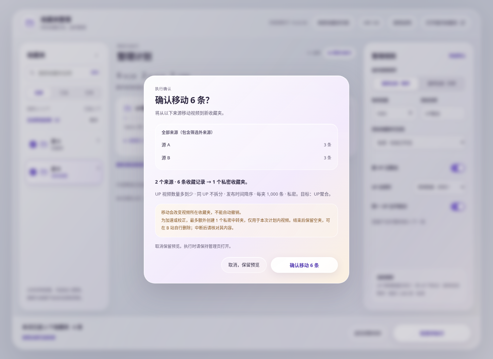

# Bilibili 收藏夹整理


<p align="center">
  <br>
</p>

<p align="center">先预览，再按你的规则整理收藏。</p>

<p align="center">
  <a href="#introduction">介绍</a> ·
  <a href="#features">主要功能</a> ·
  <a href="#installation">安装</a> ·
  <a href="#usage">使用方式</a> ·
  <a href="#faq">常见问题</a> ·
  <a href="#development">开发与测试</a>
</p>

<a name="introduction"></a>

## 👋 介绍

一个面向 **Chrome 和 Microsoft Edge** 的 B 站收藏夹整理扩展。从工具栏或收藏夹页面打开独立管理标签页，选择源收藏夹、调整规则、检查分组计划，确认后再执行移动。

项目由原油猴脚本演进而来，使用 Manifest V3。运行无需油猴、Node.js 或自建服务器，直接使用同一浏览器中的 B 站登录态。

> [!IMPORTANT]
> 当前提供本地加载版本，支持 Chromium 116 及以上版本的 Chrome / Edge。商店发布不在当前交付范围内。
>
> 自动化检查和浏览器模拟集成已通过；受云环境扩展安装策略限制，真实 Chrome / Edge 实装与 B 站账号操作仍需本机验证。建议先用少量测试收藏确认行为。

> [!CAUTION]
> 整理执行的是**移动，不是复制**。可能额外创建一个私密中转夹，仅用于本次计划内视频。
>
> 执行时请保持管理页打开。中断后视频可能位于源、目标或中转夹，请一并核对；不要删除仍有视频的中转夹。本版没有一键撤销或断点恢复。

<a name="features"></a>

## ✨ 主要功能

### 整理与预览

1. **两个入口，一个管理页**：点击扩展工具栏图标，或 B 站收藏夹页面的“整理收藏夹 ↗”控件，均可打开同一个独立标签页。
2. **查看与批量范围分开**：点击名称查看摘要，勾选框加入整理；名称搜索、全部 / 已选 / 空夹筛选均为本地操作。支持鼠标拖动框选加入范围，Ctrl / ⌘ 拖动反选，Esc 撤销本次框选；拖至列表上下边缘自动滚动，也可配合滚轮。框选与“全选筛选结果”只作用于当前筛选结果，保留筛选外已选来源。触屏可直接滑动与勾选。
3. **可配置整理规则**：支持 UP 主聚合与排列、允许拆分、发布时间升降序、自定义容量和目标可见性。
4. **先预览，再执行**：展示目标数量、UP 主分配及前几条视频的顺序，明确确认后才创建和移动。
5. **按来源复用读取数据**：同账号当前页内持续保留，读取或预览超过 10 分钟也不会过期；移除再选回不重复扫描，新增来源只读缺失部分，修改规则直接重算。执行前重新核对全部来源内容，取消确认不写入。
6. **记住设置**：在本机保存规则与账号对应的选择，支持恢复默认和清除设置。
7. **毛玻璃工作区**：中性背景、前景磨砂玻璃、完整文字标签；目录 / 范围 / 规则三栏及常驻操作区，窄窗口用原生面板保留入口。
8. **失效收藏不阻断整理**：读取时识别失效标记，预览列出数量及所在来源；仅整理其余视频，失效条目保留在原夹，不自动删除。失效条目不参与 UP 聚合或容量计算；全是失效内容时可查看预览，不能执行空任务。
9. **可理解的任务反馈**：分开显示已提交与已完整核对；任务中仍可搜索、查看任务前样本和帮助。完成后同步目录数量；停止时显示已知视频位置、未知批次和冷却倒计时。

### 提速与请求保护

1. **自适应批量**：从 2 条开始探测，核对后逐步扩大至 20、100 条；明确参数拒绝时，先核对实际归属再降低批次。
2. **按成本选择私密中转**：来源视频高度交错时，使用本次新建的一个私密中转夹汇总，再按最终顺序写入目标。
3. **方向校准与精确回退**：批量参数顺序与展示顺序相反时尝试校准；顺序不稳定时回到逐条校正。
4. **完整核对**：检查所有目标分页的每个 ID 与位置，并核对来源是否遗留计划视频，不把近似排序报告为成功。
5. **分页大小协商**：优先读取每页 100 条；接口明确拒绝或静默缩页时调整，避免跳过视频。
6. **限流即停**：保留至少 1.2 秒的串行请求间隔、风控冷却和账号变化保护；写入响应不明确时，不盲目重复请求。

### 默认规则与可选项

| 规则 | 默认 | 可选项 |
| --- | --- | --- |
| 按 UP 主聚合 | 开启 | 关闭后对全部视频按时间和容量整理 |
| UP 主排列 | 视频数量从多到少 | 从少到多、按 UP 主名称 |
| 同一 UP 主不拆分 | 开启 | 允许跨目标收藏夹拆分 |
| 发布时间 | 降序，最新在前 | 升序，最早在前 |
| 单目标容量 | 1000 条 | 1–1000 的整数 |
| 目标基础名称 | `UP聚合` | 自定义，多个目标自动增加序号 |
| 目标可见性 | 私密 | 公开 |

关闭 UP 聚合后，UP 排列和“不拆分”选项不再生效。单 UP 超过设定容量时，需要提高容量或明确允许拆分；缺失发布时间的项放在所属排序范围末尾，再按收藏时间等信息确定顺序。

### 与旧版脚本的区别

| 项目 | 原油猴脚本 | 当前扩展 |
| --- | --- | --- |
| 安装与入口 | Tampermonkey 或控制台 | 本地加载扩展，工具栏与页面双入口 |
| 操作界面 | B 站页内面板 | 独立管理标签页 |
| 源收藏夹选择 | 手动输入名称 | 搜索、多选 |
| 分组与排序 | 主要使用固定规则 | 可配置规则及时间升降序 |
| 大规模移动 | 逐条请求 | 自适应批量、中转及精确回退 |

原脚本仍保留在仓库中，说明见 [旧脚本使用方式](./docs/userscript.md)。使用扩展时请停用旧脚本，避免同时运行。

## 🖼️ 界面预览

以下为 **1.2.0 实际管理页**配合模拟 Chrome / B 站接口的截图，非真实账号数据。前景采用毛玻璃材质，背景为中性浅灰；文字操作入口完整保留。

<p align="center">
  
</p>

<details>
<summary>查看分组预览界面</summary>

<p align="center">
  
</p>

</details>

<details>
<summary>查看执行确认与任务反馈</summary>




</details>

完整变化见 [更新日志](./CHANGELOG.md)。

<a name="installation"></a>

## ⬇️ 安装

### 本地安装（当前方式）

在 GitHub 当前分支点击 **Code → Download ZIP** 获取源码并解压。也可以在本机通过 `npm run pack` 生成 `bilibili-favorites-organizer-1.3.2.zip` 后解压安装。

- 使用仓库源码：选择解压后的 **`extension/` 目录**。
- 使用打包产物：选择解压后**直接包含 `manifest.json` 的目录**。
- 本地加载不需要构建；不要选择 ZIP 文件本身或仓库根目录。

<details>
<summary>Microsoft Edge 安装步骤</summary>

1. 在地址栏输入 `edge://extensions/`。
2. 开启 **开发者模式**。
3. 点击 **加载解压缩的扩展**，选择包含 `manifest.json` 的目录。
4. 将扩展固定到工具栏。
5. 刷新已经打开的 B 站收藏夹页面，使页面入口生效。

</details>

<details>
<summary>Google Chrome 安装步骤</summary>

1. 在地址栏输入 `chrome://extensions/`。
2. 开启 **开发者模式**。
3. 点击 **加载已解压的扩展程序**，选择包含 `manifest.json` 的目录。
4. 将扩展固定到工具栏。
5. 刷新已经打开的 B 站收藏夹页面，使页面入口生效。

</details>

### 更新扩展

在没有运行任务时，用新文件替换原安装目录中的文件，然后到扩展管理页点击 **重新加载**。关闭旧管理页，重新打开扩展，并刷新 B 站收藏夹页面。

详细说明见 [安装与首次使用](./extension/INSTALL.md)。

<a name="usage"></a>

## 🧭 使用方式

1. 在同一浏览器的普通窗口登录 B 站，停用旧油猴脚本。
2. 点击扩展图标，或在 `https://space.bilibili.com/<mid>/favlist` 页面点击 **整理收藏夹 ↗**。
3. 点击 **连接并读取列表**。点击名称只查看，勾选框或鼠标拖动框选加入整理；拖到列表上下边缘会自动滚动。Ctrl / ⌘ 框选反选，Esc 取消本次框选，搜索或筛选保留其他来源的选择。打开管理页本身不会扫描视频。
4. 调整规则，点击 **生成整理预览**，核对容量、分组和目标可见性。
5. 检查所有来源（包含筛选外来源）、目标、排序与可见性。如需修改，返回调整规则；如暂不执行，取消确认保留预览。
6. 确认计划后开始移动，保持管理页打开，可切换到其他标签页。
7. 查看“已提交到目标”和“已完整核对”两组进度；全部目标与来源归属检查通过后才完成。任务期间可以查看已读内容和帮助，范围与规则锁定。异常时按位置链接核对源、目标和中转；若用了中转夹，成功后留为空夹，可自行删除。

## ⚡ 性能参考

以下为 **6000 条视频的确定性模拟**，所有场景都核对完整顺序。执行请求包含执行前来源全量核对、移动和结果校验，不包含首次预览扫描。

| 来源情况 | 接口接受的页大小 | 逐条基线执行请求 | 优化后的执行请求 | 其中移动请求 |
| --- | ---: | ---: | ---: | ---: |
| 连续来源 | 100 | 6620 | 264 | 62 |
| 六源交错 | 100 | 6620 | 485 | 136（含中转） |
| 连续来源 | 20 | 6620 | 744 | 62 |
| 六源交错 | 20 | 6620 | 1205 | 136（含中转） |

> [!NOTE]
> 这是模拟接口支持批量时的**请求量比较**，不是 B 站真实耗时或吞吐承诺。网络、接口限制、校正和降级都会影响实际速度；不支持批量时仍可能耗时较长。

最新自查覆盖 97 项回归检查，其中包含 2,000 组重复 / 失效 / 排序 / 批量异常组合，后续 `npm test` 会持续运行这些检查。详见 [整理可靠性自查](docs/reliability-audit.md)。

使用 `npm run benchmark` 可复现。详见 [性能分析](./docs/extension-performance.md) 和 [模拟数据](./docs/transfer-benchmark.json)。

<a name="faq"></a>

## ❓ 常见问题

<details>
<summary>取消之后，会修改收藏夹或刷新页面吗？</summary>

取消执行前的确认不会创建收藏夹、移动视频或刷新页面，会保留当前预览。来源数据在同账号当前管理页内持续保留；读取规模增加或预览放置较久，都不会因为固定时限而作废。移除再选回、修改规则都能复用，新增来源只读缺失数据。点击“确认移动”后会重新读取全部来源，比对 ID、失效状态与排序信息；若有变化，在创建或移动前停止，并要求重新读取。重新读取、账号变化或开始执行会清除旧缓存；任务前顺序样本仅供查看，明确标注非实时。

执行前的来源核对同样遵守 1.2 秒串行间隔；数据越多核对越久，界面显示逐页进度。读取和执行期间请保持管理页打开，并避免在其他客户端修改这些来源。

</details>

<details>
<summary>为什么会出现一个“整理中转”收藏夹？</summary>

为了加速交错来源的视频，或校正批量展示顺序，扩展可能额外创建一个本次专用的私密中转夹，执行确认中会说明。多个目标共用该夹，逐个汇入并清空。

成功后保留空夹，可自行删除。中断时请检查源、目标、中转三处，**不要删除仍含视频的中转夹**。扩展不会自动删除收藏夹，也不提供一键回滚。

</details>

<details>
<summary>触发限流或出现网络异常时怎么办？</summary>

HTTP 412 / 429 或识别到接口风控时，扩展立即停止，至少冷却 60 秒，并遵守更长的 `Retry-After`。界面显示本地冷却倒计时，并禁用新的网络操作；倒计时结束不自动续跑。实际恢复时间由 B 站决定，请避免连续执行或刷新。

写入超时、结果不明确时不会自动重放。先核对收藏夹实际状态，再决定后续操作。扩展的队列不能限制手机 App、网页自身或其他工具的请求。

</details>

<details>
<summary>哪些收藏暂时不能一起处理？</summary>

本版仅处理视频。失效视频仍计入读取总数，随后跳过并保留在原夹，其余视频正常整理；预览与确认会列出失效数量。没有自动清理或删除失效收藏的功能。发现非视频资源时，会停止并说明；预览会为与已有收藏夹重名的目标添加编号，确认时展示实际名称，不自动合并或删除已有收藏夹。若确认后又出现新的同名目标，执行前会停止以避免混入内容。

同一视频出现在多个所选源收藏夹时，按左侧列表顺序只移动第一份有效副本，其余副本留在各自原收藏夹。分组、容量和移动进度按实际移动的唯一视频计算，预览与执行确认会说明重复记录的保留数量，执行后按来源核对移动与保留归属。

</details>

<details>
<summary>支持 Firefox、无痕窗口和关闭后继续吗？</summary>

当前优先支持 Chrome / Edge，不支持无痕窗口。执行时需要保持管理页打开；暂停、断点恢复、关闭后继续和一键撤销不在当前版本中。

</details>

## 🔒 权限与本地数据

| 权限 / 域名 | 用途 |
| --- | --- |
| `storage` | 保存规则、账号对应的选择及冷却时间 |
| `cookies` | 读取 B 站现有登录 ID 和 CSRF，用于操作自己的收藏；不保存或导出凭证 |
| `www.bilibili.com` | 读取登录态 |
| `api.bilibili.com` | 访问收藏夹接口 |
| `space.bilibili.com` | 提供收藏夹页面入口 |
| `declarativeNetRequestWithHostAccess` | 仅为本扩展发起的收藏夹 API 请求设置来源头，不修改网页自身请求 |

无自建后端、外部分析或远程脚本。页面控件只负责打开管理页，不向网页提供任意 API 或 Cookie 桥接。反馈问题时，请勿分享 Cookie、CSRF 或完整请求头。

<a name="development"></a>

## 🤝 开发与测试

开发环境：**Node.js 20+、Python 3**。运行文件位于 `extension/`，无需安装应用依赖。

```sh
# 引擎、批量校正和旧脚本安全回归
npm test

# 6000 条模拟请求量对比
npm run benchmark

# 打包，仅包含运行文件
npm run pack
```

打包产物位于 `dist/bilibili-favorites-organizer-1.3.2.zip`，同时保存到 [`packages/`](packages/README.md)，附带 SHA-256。每次成品包随源码一起更新到 GitHub。

[下载最新成品包 v1.3.2](packages/bilibili-favorites-organizer-1.3.2.zip)

项目已安装 [UI UX Pro Max](https://github.com/nextlevelbuilder/ui-ux-pro-max-skill) 到 `.agents/skills/ui-ux-pro-max/`，用于后续界面与交互工作；技能不进入扩展成品包。

<details>
<summary>浏览器模拟集成检查</summary>

需要 Playwright 1.56.1 和 Chromium。以下为 Linux 示例，可将测试工具安装到仓库外：

```sh
npm install --prefix /tmp/bfo-browser-tools --no-package-lock --no-save playwright@1.56.1
BROWSER_TOOLS_DIR=/tmp/bfo-browser-tools npm run test:browser
# 只检查目录框选、滚动、筛选、键盘与触屏
BROWSER_TOOLS_DIR=/tmp/bfo-browser-tools npm run test:selection
```

默认 Chromium 路径为 `/usr/bin/chromium`，可通过 `CHROMIUM_PATH` 调整；截图输出目录可通过 `BROWSER_ARTIFACTS_DIR` 指定。

测试运行实际管理页、CSS、ES 模块、原生任务锁和页面入口代码，使用测试专用 Chrome API shim 与模拟接口。它不绕过系统扩展安装策略，也不能代替真实扩展实装和 B 站账号验证。

</details>

当前自动化检查包含 83 项测试，其中覆盖固定种子 100 组后端、来源与规则组合，以及 13 个来源的 11606 / 50000 条记录模拟；浏览器模拟另覆盖大规模预览与失效内容。具体通过项和真实环境待验证项见 [验证记录](./docs/extension-validation.md)。

| 目录 | 内容 |
| --- | --- |
| [`extension/`](./extension/) | 可直接加载的扩展及安装说明 |
| [`extension/lib/`](./extension/lib/) | 规则、队列、接口与传输引擎 |
| [`tests/`](./tests/) | 自动化检查与模拟基准 |
| [`tools/`](./tools/) | 本地打包脚本 |
| [`docs/`](./docs/) | 需求、设计及验证文档 |

功能建议或问题反馈可提交到 [Issues](https://github.com/agonielv/bilibili-favorites-organizer/issues)。请说明浏览器版本、扩展版本、出错阶段及可见提示。

## ❤️ 鸣谢

- [BewlyCat](https://github.com/keleus/BewlyCat/)：README 章节组织与排版参考。
