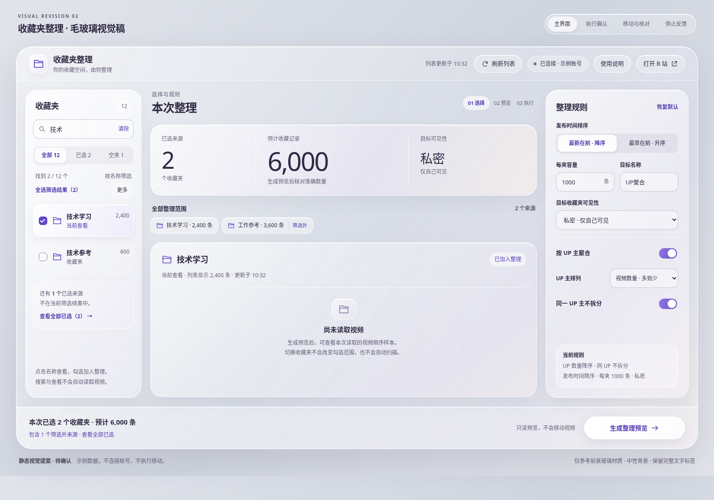

# 收藏夹整理扩展 · UX 评估与改版提案

评估对象：当前 v1.1.0 管理页；日期：2026-11-05。状态：**布局、交互与毛玻璃视觉已确认，现已落实于 1.2.0**。

本页保留对 1.1.0 的评估证据和已确认方案；下方“待确认”文字及旧草图属于设计阶段记录。当前实现、测试与实际截图见 [1.2.0 验证记录](../extension-validation.md)。

建议先明确“当前查看哪个收藏夹、本次选中了哪些收藏夹、任务究竟进行到哪里”。用户已认可本提案的布局与交互，视觉改为参考用户图片的**前景毛玻璃材质**：透光、磨砂、细亮边及柔和圆润控件。背景保持中性，操作继续保留文字标签。

## 最新视觉提案

查看[毛玻璃视觉说明与浏览器预览](glass/README.md)。本版替代下方旧草图的美术风格，布局与交互约束继续沿用。

| 视觉稿 | 重点 |
| --- | --- |
| [主界面](glass/01-workspace.png) | 三栏布局、前景玻璃分层、常驻操作区 |
| [执行确认](glass/02-confirmation.png) | 高密度磨砂确认框，信息完整可读 |
| [任务反馈](glass/03-task-feedback.png) | 提交与核对分开，任务设置只读 |
| [窄窗口](glass/04-compact.png) | 保留文字与操作入口 |
| [停止反馈](glass/05-cooldown.png) | 冷却、未知状态与安全下一步 |



## 旧版布局草图（仅保留结构参考）

以下草图的结构已获确认，美术风格已由上方毛玻璃版本替换。所有图中的内容和数字均为示例，不是已经实现的界面。

| 草图 | 重点 |
| --- | --- |
| [01 · 收藏夹、范围与规则](01-workspace.png) / [SVG](01-workspace.svg) | 左侧目录；查看与勾选分开；中间显示范围；底部常驻主操作 |
| [02 · 预览与执行确认](02-confirmation.png) / [SVG](02-confirmation.svg) | 核对全部来源、目标、排序和可见性；取消保留预览 |
| [03 · 移动、核对与停止反馈](03-task-feedback.png) / [SVG](03-task-feedback.svg) | 分开显示提交与核对；明确中转位置；冷却不自动重试 |
| [04 · 窄窗口布局](04-compact.png) / [SVG](04-compact.svg) | 保留目录、范围和主操作；规则收进有摘要的面板 |

## 评估方法与适用范围

按已安装的 **UI UX Pro Max** 流程：识别产品与技术栈 → 对照 Quick Reference 走查现有 UI → 对四个重点分别检索 UX 指引 → 核验结果适用平台 → 形成布局、状态和验收方案。

- 产品：面向个人用户的桌面浏览器收藏夹批量整理工具，主要服务 Chrome / Edge。
- 技术栈：Manifest V3、原生 HTML / CSS / JavaScript ES modules，无 React、Vue、Tailwind。本方案继续使用现有技术栈，不新增 UI 框架、外部字体或运行时依赖。
- 查看了实际 `manager.html`、`manager.css`、`manager.js` 及任务状态来源；使用 Chromium 加载实际页面和模块，配合模拟 Chrome / B 站接口走查，不沿用旧原型作为现状证据。
- 模拟数据含 12 个收藏夹，其中 2 个名称匹配“技术”；移动场景使用 6 条记录。没有访问真实账号，没有执行真实收藏夹移动。你的实际功能测试通过，继续作为真实环境的功能依据。
- 云端浏览器限制加载未打包扩展，因此这些证据覆盖管理页 UI 与交互，不代表本轮完成了扩展安装、真实账号接口或商店审核测试。
- 本轮是专家走查与场景复现，没有用户访谈或可用性评分，不把推测包装成实际用户事故，也不据此推算真实移动耗时。

Skill 来源：[nextlevelbuilder/ui-ux-pro-max-skill](https://github.com/nextlevelbuilder/ui-ux-pro-max-skill)，安装版本 `b7d5353e0130feb8c5574ef1251f8a1db1873ccb`。

| 重点 | 本地检索 | 采用的指引 |
| --- | --- | --- |
| 收藏夹切换 | `state preservation navigation` / `ux` | Active State；返回保留状态采用 Quick Reference 的 `state-preservation` |
| 搜索筛选 | `filter empty state` / `ux` | Empty States、Chip Collection Reflow |
| 批量移动 | `confirmation destructive actions` / `ux` | Confirmation Dialogs、Confirmation Messages |
| 操作反馈 | `loading progress feedback` / `ux` | Progress Indicators、Loading Indicators |
| 键盘操作 | `focus management keyboard` / `ux` | Focus States、Focus Not Obscured；区分 WCAG AA 与 AAA |
| 视觉方向（更新） | `Glassmorphism` / `style` | 已核验的 `glassmorphism`，按用户前景材质参考调整；旧版 Apple Native 视觉已替换 |

设计系统搜索 `desktop productivity organizer` 返回营销页的 Product Demo + Features；按流程仅重试一次 `desktop collection manager` 后仍返回 Hero / CTA 结构。因此未将其保存为设计系统，也未套用营销页布局。布局来自适用的 UX 指引及本项目实际界面；最新视觉遵循用户提供的前景毛玻璃参考。没有将移动端手势、触觉反馈或底部导航生搬到桌面扩展；没有把 Tailwind 的栈规则用于原生 CSS。

## 已观察到的问题

P0 表示可能让操作范围超出用户从界面获得的预期，应优先修正；P1 表示影响判断、连续操作或可访问性；P2 表示视觉与布局优化。以下是 UX 优先级，不是对现有移动引擎的故障评级。

| 优先级 | 观察与复现 | 影响 | 建议 |
| --- | --- | --- | --- |
| **P0** | 搜索“技术”只显示 2 个收藏夹，点“全选”后选中 12 个，包括 10 个不可见来源 | “全选”的范围不明确，有把隐藏来源纳入移动的风险；未声称真实用户已误操作 | 改为“全选筛选结果（2）”；总范围始终可见；确认框列出全部来源 |
| P1 | 整行是勾选标签，没有独立的“当前查看”状态；取消再勾回同一来源后生成预览，会再次读取两份来源数据 | 查看与批量范围混在一起，范围试选也可能使可复用数据失效 | 行名称负责查看，勾选负责范围；查看不清缓存；同一页有效来源缓存可复用 |
| P1 | “核对完整展示顺序”时显示 `6 / 6`，进度样式已设置为 `100%`；页面底部仍显示“尚未创建收藏夹或移动视频” | 用户难以分辨“已提交”“正在核对”“全部完成”；进度 CSS 动画会使截图宽度暂时滞后于样式值 | 统一任务状态；分开显示提交数和完整核对数；最终来源检查通过才显示成功 |
| P1 | 生成预览或执行时，搜索、使用说明、打开收藏夹等按钮与修改控件全部禁用 | 长任务期间页面像整体不可用，无法查看帮助或本地信息 | 只锁定会改变任务的控件；本地筛选、查看缓存、帮助保持可用 |
| P1 | 完成后源收藏夹在模拟后端已为 0 条，返回选择页仍显示原来的 6 条 | 下次整理时数字与实际状态不一致 | 使用执行末尾已获得的列表元数据更新目录；不额外全量扫描视频 |
| P1 | 键盘聚焦复选框并按空格，目录重建后焦点回到 `BODY`；900px 窗口导航出现 3 个无名称按钮 | 连续键盘选择中断；图标导航无法被辅助技术识别 | 保留稳定 DOM / 焦点；图标按钮始终提供可访问名称 |
| P1 | 容量填 `1001` 后错误只在全局显示，字段没有 `aria-invalid` / `aria-describedby` | 用户需要寻找出错字段；读屏难以建立错误关联 | 就地错误、字段关联、提交失败后聚焦首个无效字段 |
| P1 | 模拟风控后已有冷却保护，但“生成预览”外观仍可点击；异常主要依赖长文本 | 用户容易反复点击，不清楚何时可尝试、视频在哪里 | 持续的停止 / 冷却卡片；显示剩余时间和位置，网络操作在冷却期禁用 |
| P2 | 1440×960 下仅 12 个收藏夹已让主操作落到首屏外；规则说明实测 10px | 随收藏夹增多，主操作难找；长文本阅读吃力 | 目录占独立区域；底部常驻范围和主操作；正文 14–16px，辅助文字至少 12px |
| P2 | 搜索无结果只有文字；连接后刷新与生成预览都使用强蓝色 | 恢复路径、当前主操作不够明确 | 加“清除搜索”及已选范围提示；刷新降为次操作 |

当前搜索框是 `type="search"`，浏览器可能提供原生清除控件；上表指无结果区没有应用提供的明确恢复按钮，并非断言用户完全无法清除搜索。

证据：[场景记录](observations.json)、[现有目录](current-collections.png)、[筛选与全选](current-filter-scope.png)、[现有确认框](current-confirmation.png)、[核对阶段反馈](current-feedback.png)。

代码定位：[目录与选择](../../extension/manager.js#L66)、[全选](../../extension/manager.js#L230)、[忙碌状态](../../extension/manager.js#L49)、[确认与进度](../../extension/manager.js#L184)、[执行与完成](../../extension/manager.js#L196)、[任务状态](../../extension/lib/runner.js#L6)。

## 保留的现有设计

- 打开管理页不自动读取视频；显式生成预览后才读取。
- 执行前确认；取消确认没有创建 / 移动请求，也没有重新扫描，预览继续可见。这一点在本轮模拟场景复核正常。
- 修改规则复用有效预览、账号变化使预览失效、执行前校验来源，继续保留。
- 按 UP 主数量分组、同 UP 不拆分、发布时间升序 / 降序、容量及私密目标的默认值与可选项继续保留。
- 自适应批量、精确排序、完整核对、串行限速、风控停止和不确定写入不自动重放，继续保留。

## 推荐布局

将现有占宽的品牌导航收进紧凑顶栏，把左侧空间给用户实际需要反复切换的收藏夹目录。

```text
┌ 收藏夹整理 ───────────────────── 账号 · 列表更新时间 · 帮助 · 打开 B 站 ┐
│ 收藏夹目录          │ 本次整理 / 整理计划                 │ 整理规则   │
│ 搜索名称 [清除]     │ 已选来源、预计记录数                 │ 时间排序   │
│ 全部 / 已选 / 空夹  │ 当前查看的收藏夹摘要                 │ 容量与命名 │
│ 全选筛选结果 (N)    │ 未读取：明确提示；不自动加载视频     │ 可见性     │
│ □ 名称       数量   │ 已读取：展示有效缓存中的顺序样本     │ UP 主分组  │
│ ☑ 当前夹     数量   │ 生成后：目标分组、容量、排序样本     │ 规则摘要   │
├──────────────────────────────────────────────────────────────────────┤
│ 本次已选 2 个 · 包含筛选外 1 个 · 预计 6,000 条       [生成整理预览]  │
└──────────────────────────────────────────────────────────────────────┘
```

- **左侧 264–280px**：目录、名称搜索、筛选及范围操作。目录有可辨识滚动区域，避免整页被列表撑长。
- **中间弹性宽度**：默认展示本次整理范围；点击名称查看该收藏夹摘要。生成后切到整理计划，返回可恢复筛选、目录滚动位置及焦点。
- **右侧 300–320px**：排序、容量、名称、可见性；UP 聚合相关选项成组展示，可折叠但保留完整规则摘要。目标为公开时明确文字提示。
- **底部操作区**：本次范围与唯一主操作。必须预留内容空间和滚动偏移，避免遮挡末行及键盘焦点。
- >=1280px 使用三栏；1024–1279px 保留目录与内容，规则进入有摘要的侧面板；<1024px 目录收进有文字标签的抽屉，内容单栏。帮助、账号、范围入口始终可达，200% 缩放时允许工具栏换行。
- 列表和正文只在确有需要时独立滚动，不让同一区域再嵌多层滚动。长名称优先换行，必要截断须有键盘可达的完整名称展示。

### 收藏夹切换与搜索

1. **两个独立状态**：当前查看的收藏夹只有一个；参与批量整理的来源可以有多个。名称按钮改变前者，复选框改变后者。用“当前查看”文字 / 边线与勾选状态共同区分，不能只靠颜色。名称按钮和复选框是相邻控件，不相互嵌套。
2. **切换不发请求**：未读取时只显示数量、列表更新时间及“尚未读取视频”；只有“生成预览”才读取所选来源。读取后可显示现有缓存的顺序样本；不是新增完整视频浏览器，不加入逐条勾选、删除或搜索视频内容。
3. **搜索只影响可见列表**：明确“搜索收藏夹名称”；显示“找到 2 / 12 个”。清除搜索不清除勾选；切换“已选”“空夹”也不改变实际范围。
4. **范围操作写清对象**：主入口“全选筛选结果（N）”；旁边“取消选择筛选结果”。“选择全部收藏夹”“取消所有选择”放在范围菜单，均写明数量。不使用含义模糊的“清空”。
5. **隐藏选择可审查**：底部显示“已选 X 个，其中 Y 个不在当前筛选中”；“查看全部已选”展开完整来源清单。来源标签过多时显示可操作的“另 N 个”，不能把它做成不可点击的装饰。
6. **空状态有动作**：无搜索结果 → “清除搜索”；列表确实为空 → 解释当前账号无来源；接口失败 → 保留已有目录，展示失败和安全重试入口。三种状态不混用。
7. **缓存按有效来源管理**：同账号、同页 10 分钟内复用已读取的来源；纯查看 / 搜索不使数据失效。新增未读来源需用户再次生成预览，只读缺失来源。移除再加回同一来源可复用有效缓存。计划有效期取参与来源中最早的过期时间，重算不延长有效期。执行、显式刷新、账号变化后使相关缓存失效；不落盘视频数据，不绕过执行前的新鲜度与来源校验。

### 预览与批量移动

- 预览顶部同时展示**来源数量、准确收藏记录数、目标数量**；读取前目录合计标注“预计”，不把列表元数据当成已逐条核验的数量。不同来源中的重复视频仍按实际收藏记录语义计数。
- 每个目标保留名称、容量、UP 分布和顺序样本；当前只显示前 3 条时继续如实标注，不暗示界面已经列出全量视频。
- 执行确认框新增全部来源清单：前几项直接显示，余项可展开，包含筛选外来源。确认前核对总记录数、目标名称 / 数量、排序、可见性以及可能使用的私密中转夹。
- 按钮写明动作：“取消，保留预览” / “确认移动 6,000 条”。原生 `<dialog>`、Esc 取消、焦点约束和关闭后焦点返回继续保留；不增加重复确认复选框。
- 预览过期时保留内容但标注失效，主操作改为“重新生成预览”。执行过或发生不确定写入的旧预览不能直接再次执行。
- 本提案改善浏览响应和减少可避免的重复读取，**不改变 API 间隔、并发、批次探测或排序算法**，不承诺未经实测的移动耗时提升。

### 操作反馈与任务状态

| 状态 | 中间区反馈 | 可用操作 | 锁定 / 不提供的操作 |
| --- | --- | --- | --- |
| 未连接 / 未选来源 | 账号与明确下一步 | 连接、搜索已有目录、帮助 | 无范围时不能生成 |
| 正在读取 | 当前来源、已读页 / 条数、稳定占位 | 搜索、查看本地信息、帮助 | 修改任务范围 / 规则、新读取任务 |
| 预览可用 | 来源与目标计划、采集时间与有效性 | 修改范围 / 规则、检查执行、取消确认 | 取消确认不得写入或重新扫描 |
| 正在执行 | 当前阶段、目标名、提交与核对数 | 本地搜索、查看缓存、帮助 | 范围、规则、刷新、新任务；不新增暂停 / 恢复 / 撤销按钮 |
| 冷却 / 异常停止 | 原因、已知进度、未知批次、位置与下一步 | 查看来源 / 目标 / 已有中转位置、帮助 | 冷却期的新网络操作；不自动重试不确定写入 |
| 完成 | 已移动并核对、来源归属检查通过、目录更新 | 查看位置、开始下一次整理 | 旧计划再次执行 |

建议沿用引擎真实事件显示：**读取预览 → 准备 → 移动并核对各目标 → 检查来源归属 → 完成**。现有引擎是逐目标移动和完整核对交替进行，不画成所有移动结束才统一开始核对的虚假线性流程。

任务卡应清楚区分：

- **已提交到目标 N / 总数**：来自现有 `confirmed`；说明仍可能校正，不等于最终完成，中转搬运不重复累加成工作量。
- **已完整核对 M / 总数**：来自 `verified`，以完成整夹核对为单位增加；不伪造逐条平滑进度。显示当前目标和阶段，减少整夹核对期间的等待疑惑。
- **本批状态待核对 K 条**：异常时用 `pending` 及错误类型说明不确定性，不能默认为成功，也不能提供盲目重放按钮。
- 即使目标核对达到总数，来源归属检查仍显示“进行中”；仅收到最终成功事件后显示“整理完成”。校正时保留已核对数，明确“当前目标正在校正”，允许提交数如实变化，不把它画成倒退的总体完成率。

所有长期状态集中到任务卡，阶段标题、状态条和主按钮由同一个状态来源更新。普通设置保存可用轻提示；错误、冷却、执行与完成信息持续保留在当前工作区，不新建结果页。

冷却卡示例：“请求已停止 · 至少 00:48 后可再次尝试。服务端恢复可能更久。”倒计时来自已有冷却截止时间，本地更新，不轮询接口、不自动续跑。读取失败且未写入时保留有效缓存；执行后缓存仍失效。中断后列出已知来源、目标、中转夹及可打开的具体位置，说明未知状态，避免笼统要求用户重新执行。

成功时用执行末尾已获取的收藏夹元数据同步目录数量、目标和中转位置；后续实现可让执行结果返回这份已有数据，不新增全量视频请求。失败后旧目录标记“任务前数据，待核对”，不能直接根据提交数推算精确余量。

### 可访问性与视觉规范

- 系统字体：`system-ui, -apple-system, BlinkMacSystemFont, "Segoe UI", sans-serif`，中文使用系统回退；无需外部字体请求。标题 22–28px、正文 14–16px、辅助文字 12–13px，行高约 1.5。数字使用等宽数字样式。
- 最新视觉按用户参考采用前景毛玻璃：半透明填充、真实背景模糊、细白亮边、内高光与圆润控件；窗体 / 面板 / 确认框有不同透光度。布局和信息层级保持，背景用中性浅灰。具体材质参数见[第二版视觉说明](glass/README.md)。
- 颜色以语义变量定义，最新稿主文字 `#302A43`、次文字 `#625B74`、操作紫 `#6146C6`；正常文字对比度目标 >=4.5:1，以实际合成背景核验。状态同时有文字 / 图标，不能只用红绿区分。
- 保留原生按钮、复选框、单选组与对话框语义。自绘输入边界、焦点和状态标识分别验收，不能凭浅色分隔线认定控件可辨识。Web 目标大小按 WCAG 2.2 AA 的 24×24 CSS px 或适用例外核验；本项目主要操作采用约 44px 高作为更易操作的设计目标，不混用 iOS 的 pt 单位。
- 目录勾选或筛选更新后保留焦点；规则抽屉 / 对话框关闭后焦点回到触发器；表单错误与字段关联。紧凑布局的图标按钮仍有完整可访问名称。
- 使用一个适当的 `aria-live="polite"` 状态区，阶段变化完整播报，数量节流更新，不播报每次请求。进度条提供名称与数值；关键失败在对应位置可读，避免多个区域重复播报同一异常。
- 常驻底栏不完全遮挡焦点为 AA 要求；尽量完整可见是更高的设计目标，不把 AAA 当成 AA 合规结论。支持键盘、200% 缩放及减少动态效果。
- 本轮提供浅色玻璃方案及减少透明度 / 不支持模糊时的实色回退；深色主题暂不扩入本次实施范围，不宣称已完成全面 WCAG 审计。

## 确认后的实施边界与验收

建议分两步实施，但本轮都不改代码：

1. 先完成范围语义、统一任务反馈、目录同步、焦点及表单错误，沿用现有移动引擎与保护机制。
2. 再落地目录 / 内容 / 规则布局、常驻操作区、响应式与视觉规范；复用本页有效来源缓存。必要的元数据 / 进度传递只暴露已有信息，不改变请求策略。

不增加备份、导出、单独结果中心、完整视频管理、标签系统、暂停续跑、撤销、后台关页续跑或额外并发加速。

实施后的主要验收场景：

- 搜索只出现 2 个来源时，“全选筛选结果”只增加这 2 个；筛选外已有选择可见且能完整审查。
- 查看收藏夹、清除搜索、打开帮助不会改变批量范围，也不触发视频请求；有效缓存内移除再勾回同一来源不重复读取。
- 取消执行不产生写入、不扫描、预览保留；确认框包含全部来源和准确总量。
- 移动 / 核对 / 来源检查期间只有一个一致的任务状态；已提交全部时不会直接显示“整理完成”；中转不重复计入整理总量。
- 执行中本地搜索和帮助可用，任务范围与规则保持锁定；冷却期间网络操作禁用且倒计时不会自动触发请求。
- 异常后的未知批次和位置有明确说明，没有不确定写入的一键重试；完成后目录数量与本轮已获取元数据同步。
- 键盘连续勾选不丢焦点；900px 窗口的按钮名称可被读屏识别；容量错误就地可读并关联字段。
- 长目录下主操作可达；1440px、1024px、窄窗口与 200% 缩放无横向溢出或焦点被底栏遮挡。
- 继续运行原有请求安全与排序回归检查；新增验证仅围绕上述可观察的交互，不照抄 DOM 实现写测试。

旧版交付检查：4 张 SVG 已在 Chromium 中渲染为 PNG，并检查画布文字边界与文档链接。最新毛玻璃稿使用实际 HTML / CSS 渲染，检查记录见 [render-checks.json](glass/render-checks.json)。`extension/` 下 17 个文件与评估前的 SHA-256 基线一致；未修改应用代码，本轮未重复运行业务回归测试。以上检查不能替代实施后的交互、缩放及可访问性验收。

已确认的核心方向：**采用“左侧收藏夹目录 + 中间范围 / 预览 + 右侧规则 + 底部常驻操作”，并将“点击名称查看”与“勾选参与整理”分开。**用户已确认最新毛玻璃视觉，方案已进入并完成 1.2.0 实施。
