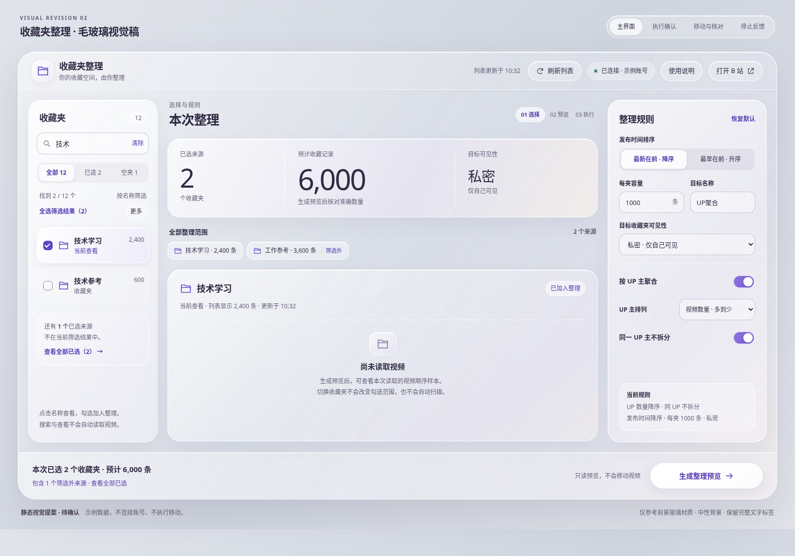

# 毛玻璃视觉提案 · 第二版

状态：**布局、交互与本版视觉均已确认，并已落实于 1.2.0。**

本目录保留设计阶段的静态稿（含原来的“待确认”标记）；当前运行界面的截图和测试见 [1.2.0 验证记录](../../extension-validation.md)。

本版按用户提供的图片，参考**前景**的磨砂透光、玻璃叠层、细白亮边、柔和圆角和圆润控件。背景使用中性浅灰，不采用参考图的蓝紫底图、环形装饰或其他背景元素。

## 查看设计

- [主界面](01-workspace.png)：目录 / 范围 / 规则三栏与常驻底栏。
- [执行确认](02-confirmation.png)：浮起的磨砂玻璃对话框，完整保留来源、数量、可见性和中转说明。
- [移动与核对](03-task-feedback.png)：同一材质下的两种真实进度，任务设置以只读信息呈现。
- [窄窗口](04-compact.png)：保留目录和内容，规则按需打开。
- [冷却与停止](05-cooldown.png)：玻璃面板内使用清晰文字说明状态、未知批次和下一步。
- [浏览器静态预览](preview.html)：单文件 HTML / CSS，顶部可切换设计稿视图；示例数据，不连接账号、不调用 B 站接口、不执行移动。它是设计交付物，不是扩展新版本。

## 从参考图提取的视觉特征

| 特征 | 本版表达 |
| --- | --- |
| 磨砂透光 | 面板使用半透明填充和真实 `backdrop-filter`；背景细节穿过玻璃后模糊，文字本身保持清楚 |
| 细亮边与内高光 | 1px 半透明白边，顶边更亮；轻微内阴影形成边缘厚度，避免厚描边 |
| 玻璃叠层 | 主窗、目录 / 规则、局部卡片和确认框有不同透光度；层级来自材质与距离，而非堆叠不透明白卡 |
| 柔和色泽 | 玻璃本体带轻微淡紫 / 暖白透色；只用于前景材质，不绘制新的彩色背景图 |
| 圆润控件 | 窗体约 36px、主要面板 26px、局部卡片 17–21px；主按钮使用白色胶囊与紫色文字，次按钮保留半透明边界 |
| 信息优先 | 浅色玻璃上使用深色文字；搜索、筛选、规则、确认和进度都保留文字，图标作为补充 |

不是复制参考图中的手机比例、运动数据、底部图标导航或背景。产品结构沿用已确认的桌面工作区。

## 继续保留的交互约束

1. 点击名称查看，复选框加入批量整理；切换与搜索不自动读取视频。
2. “全选筛选结果”写清范围；筛选外来源继续计入总量，并可完整查看。
3. 生成预览前不写入；确认框保留全部来源和风险说明；取消保留预览。
4. 提交数与完整核对数分开；来源归属检查通过后才完成。冷却不自动重试，不新增暂停、续跑或撤销。
5. 浏览 / 搜索 / 帮助与任务修改分开管理；任务执行时锁定范围和规则。
6. 沿用原生 HTML / CSS / JavaScript 与 MV3；不增加前端框架、外部字体、图库或新网络请求。

## 材质与可读性约束

- 正文主色 `#302A43`、次文字 `#625B74`、操作紫 `#6146C6`；玻璃填充根据层级调整，不将文字整体设置透明度。
- 主窗磨砂约 24px，主要面板约 16px，执行确认约 32px。确认框的玻璃更密，背景只保留模糊形状，不让来源名称和进度线干扰确认信息。
- 正常文字对比度目标至少 4.5:1；半透明材质需按浏览器合成后的实际背景核验，不能只计算未合成的 CSS 色值。大数字可更轻，表单标签、数量和操作按钮保持明确。
- 当前查看、勾选、禁用、只读、错误、冷却都有文字或形状区别。交互控件提供焦点环，悬停只增强表面亮度，不改变内容位置。
- 不制作持续流动背景、呼吸光或大范围动态模糊。减少动态效果时关闭过渡；减少透明度或不支持 `backdrop-filter` 时使用实色表面回退。
- 实施时控制模糊层数量；列表行不逐个叠加实时模糊。真实扩展内的性能、焦点管理、模态语义和读屏播报仍需按原方案验收，不能把这份静态稿视为已实现的功能。

## 核验与依据

沿用 **UI UX Pro Max**，本次按明确视觉方向检索 `Glassmorphism`（style），核验命中 `glassmorphism`；对文字检索 `color contrast readability`（ux），采用 Contrast Readability、Color Contrast 和 Color Only 指引。用户明确指定的参考范围优先于数据集的通用风格建议。

设计采用原生 HTML / CSS 高保真稿，可直接观察真实背景模糊、透明度、字体、悬停和键盘焦点效果；没有用静态白色卡片代替毛玻璃材质。

已在 Chromium 中渲染桌面、确认、执行、停止与 1200px 窄窗口；另检查 390px 的横向排版。[渲染检查](render-checks.json)记录浏览器宽度、可见文字溢出检查和样式结果。静态稿的冷却数字和执行数据为固定示例，并非运行中的任务。

本视觉已获用户确认。扩展的运行文件位于 `extension/`，设计稿不参与打包。
